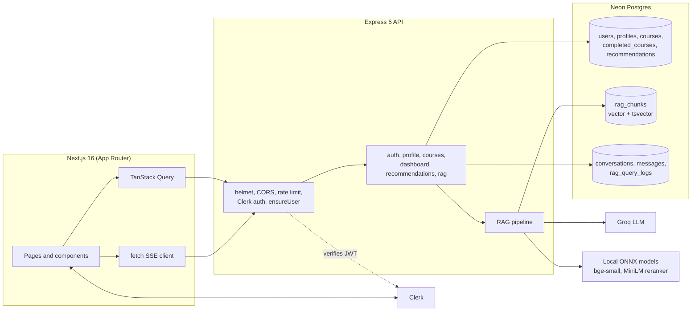
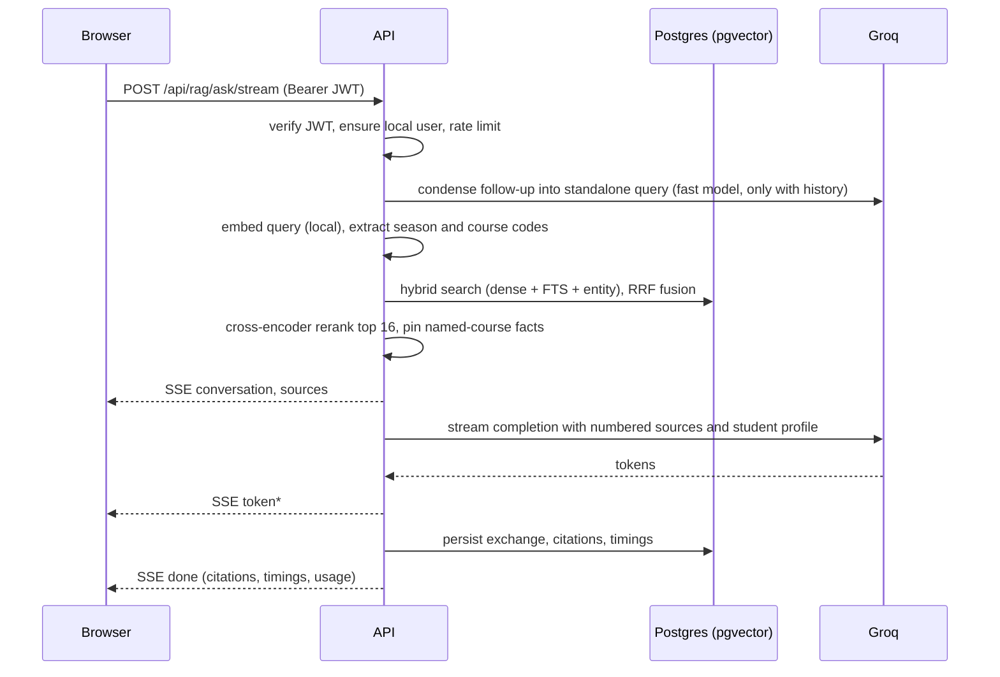
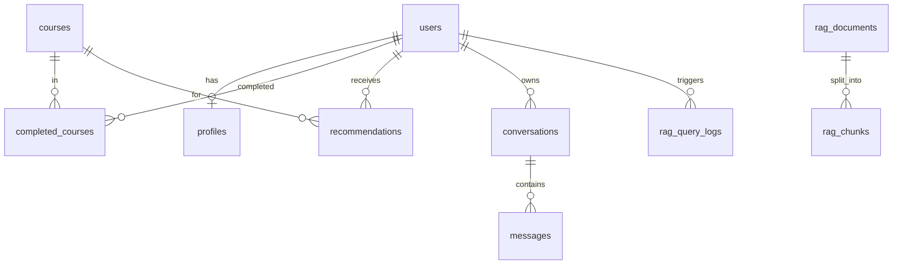

# ICA: Intelligent Course Advisor

A full-stack course-advising platform for IIIT Hyderabad MTech students. Students sign in, describe their program and goals, log completed courses, and get (1) cited answers to course questions from the official Monsoon and Spring syllabi and (2) personalised, explained course recommendations.

The system is a modular-monolith REST API (Express) with a Next.js client. Retrieval-augmented generation (RAG) runs on Neon Postgres with `pgvector`, local ONNX embedding and reranking models, and Groq for generation. There is no separate vector database and no embedding API.

- [Highlights](#highlights)
- [Architecture](#architecture)
- [Tech stack](#tech-stack)
- [Repository layout](#repository-layout)
- [Getting started](#getting-started)
- [Configuration](#configuration)
- [Data model](#data-model)
- [API reference](#api-reference)
- [RAG pipeline](#rag-pipeline)
- [Security](#security)
- [Frontend](#frontend)
- [Testing and evaluation](#testing-and-evaluation)
- [Operations](#operations)
- [Design decisions and trade-offs](#design-decisions-and-trade-offs)
- [Known limitations and roadmap](#known-limitations-and-roadmap)

## Highlights

- **Grounded answers with citations.** Every claim in an advisor answer carries a `[n]` marker linked to the syllabus section it came from. When the sources do not contain the answer, the model says so.
- **Hybrid retrieval.** Dense vector search (HNSW), Postgres full-text search and course-entity matching are fused with Reciprocal Rank Fusion in a single SQL round trip, then reranked by a cross-encoder.
- **Streaming UX.** Answers and recommendations stream over Server-Sent Events; sources arrive before the first token.
- **Personalisation.** The student's program, goal, semester and completed courses are injected into answers and drive recommendation candidates.
- **Secure by default.** Clerk JWT verification on every API route, per-user data scoping, rate limiting, strict input validation, admin-only writes.
- **Operable.** Env validation at boot, health endpoint, graceful shutdown, per-request RAG timing and token logs, idempotent ingestion, retrieval evaluation harness.

## Architecture



### Request path for an advisor question



### Backend structure

The API is a modular monolith organised by feature under `backend/src/services/`. Each module follows the same layering: `routes` → `validator` (zod) → `controller` → `service` → `repository` (Drizzle). Cross-cutting concerns live in `middleware/` and `config/`. The RAG engine (`backend/src/rag/`) is independent of HTTP and is called by both the RAG and recommendation services.

## Tech stack

| Layer | Choice |
|---|---|
| Frontend | Next.js 16 (App Router, Turbopack), React 19, Tailwind CSS 4, shadcn/ui, TanStack Query 5, react-markdown |
| Auth | Clerk (`@clerk/nextjs`, `@clerk/express`) |
| API | Node.js 20+, Express 5, zod, helmet, express-rate-limit |
| Database | Neon serverless Postgres, Drizzle ORM, `pgvector` (HNSW), Postgres full-text search |
| Embeddings | `Xenova/bge-small-en-v1.5` (384-d), local via `@huggingface/transformers` (ONNX, int8) |
| Reranking | `Xenova/ms-marco-MiniLM-L-6-v2` cross-encoder, local |
| LLM | Groq: `openai/gpt-oss-120b` (answers, ranking), `openai/gpt-oss-20b` (query condensation) |

## Repository layout

```
.
├── README.md
├── RAG_PIPELINE.md               RAG deep dive (flow, schema, metrics)
├── backend/
│   ├── index.js                  Entry: env check, cache load, model warm-up, graceful shutdown
│   ├── data/
│   │   ├── monsoon.json, spring.json   Course catalog (119 courses)
│   │   └── syllabi/*.md                Syllabus sources for RAG (6 files)
│   ├── eval/golden.json          Labelled retrieval questions
│   ├── scripts/                  setupDb, seed, ingest, evalRag, recalcCredits
│   ├── test/rag.test.js          Unit tests (node:test)
│   └── src/
│       ├── app.js                Express app composition
│       ├── config/               env (zod), groq client, course cache
│       ├── db/                   Neon client, Drizzle schema
│       ├── middleware/           auth, validate, rateLimit, errorHandler
│       ├── rag/                  chunker, models, ingest, queryAnalyzer, retriever, prompts, pipeline
│       └── services/             auth, profile, courses, dashboard, recommendations, rag
└── frontend/
    ├── app/                      Routes: /, /dashboard, /advisor, /courses, /recommendations, /profile, /onboarding, sign-in, sign-up
    ├── components/               Navbar, PageHeader, advisor/*, courses/*, ui/* (shadcn)
    ├── hooks/                    TanStack Query hooks, useAdvisorChat, useStreamingRecommendations
    ├── lib/                      axios (Clerk token), sse (fetch streaming), constants
    └── proxy.js                  Clerk route protection (Next 16 proxy convention)
```

## Getting started

### Prerequisites

- Node.js 20 or newer
- A [Neon](https://neon.tech) project (pgvector is available on all plans)
- A [Clerk](https://clerk.com) application
- A [Groq](https://console.groq.com) API key
- About 150 MB of disk for the cached ONNX models (downloaded on first run)

### 1. Install

```bash
cd backend  && npm install
cd ../frontend && npm install
```

### 2. Configure

```bash
cp backend/.env.example  backend/.env
cp frontend/.env.example frontend/.env.local
```

Fill in the values described in [Configuration](#configuration).

### 3. Provision the database and index the syllabi

```bash
cd backend
npm run setup
```

`setup` runs three steps in order: `db:setup` (enable pgvector, push schema), `seed` (load the course catalog), `rag:ingest` (chunk, embed and store the syllabi). The first run downloads the embedding model; ingestion of roughly 930 chunks takes about a minute on a laptop CPU.

> If you are migrating a database from the earlier PageIndex version, `drizzle-kit push` may ask whether new tables are renames of the legacy `documents` and `course_chunks` tables. Answer "create", or create the new tables manually and drop the legacy ones when you are ready.

### 4. Run

```bash
# terminal 1
cd backend && npm run dev        # http://localhost:8000

# terminal 2
cd frontend && npm run dev       # http://localhost:3000
```

Open the app, sign up, complete onboarding, then try the AI Advisor.

### Making someone an admin

Set `{"role": "admin"}` in the user's **public metadata** in the Clerk dashboard. Admins can create, edit and delete catalog courses and call `/api/rag/search` and `/api/rag/stats`.

## Configuration

### Backend (`backend/.env`)

Validated with zod at startup; the process exits with a clear message on invalid or missing values.

| Variable | Required | Default | Purpose |
|---|---|---|---|
| `DATABASE_URL` | yes | | Neon connection string |
| `CLERK_SECRET_KEY` | yes | | Verifies session tokens, reads user metadata |
| `CLERK_PUBLISHABLE_KEY` | yes | | Clerk instance |
| `GROQ_API_KEY` | yes | | LLM access |
| `GROQ_CHAT_MODEL` | no | `openai/gpt-oss-120b` | Answers and recommendation ranking |
| `GROQ_FAST_MODEL` | no | `openai/gpt-oss-20b` | Query condensation |
| `EMBEDDING_MODEL` | no | `Xenova/bge-small-en-v1.5` | Must output 384 dims (see schema) |
| `RERANK_MODEL` | no | `Xenova/ms-marco-MiniLM-L-6-v2` | Cross-encoder |
| `RAG_RERANK` | no | `true` | Disable to trade accuracy for ~2 s lower latency |
| `MODEL_CACHE_DIR` | no | `.model-cache` | ONNX model cache |
| `PORT` | no | `8000` | |
| `CORS_ORIGINS` | no | `http://localhost:3000,http://localhost:3001` | Comma-separated allow-list; also used as Clerk `authorizedParties` |
| `NODE_ENV` | no | `development` | `production` hides 5xx error messages |

### Frontend (`frontend/.env.local`)

| Variable | Purpose |
|---|---|
| `NEXT_PUBLIC_CLERK_PUBLISHABLE_KEY`, `CLERK_SECRET_KEY` | Clerk |
| `NEXT_PUBLIC_API_URL` | API base, default `http://localhost:8000/api` |
| `NEXT_PUBLIC_CLERK_SIGN_IN_URL`, `..._SIGN_UP_URL`, `..._AFTER_SIGN_IN_URL`, `..._AFTER_SIGN_UP_URL` | Auth routing |

Never commit `.env` files. They are git-ignored; only `.env.example` is tracked.

## Data model



| Table | Notes |
|---|---|
| `users` | Mirror of the Clerk user, keyed by unique `clerk_id`; created on first authenticated request |
| `profiles` | program, semester, goal, `credits_completed` (derived from completed courses) |
| `courses` | 119-course catalog; held in an in-memory cache and reloaded on writes |
| `completed_courses` | user, course, grade |
| `recommendations` | Latest AI-ranked set per user; replaced atomically |
| `rag_documents` | One row per source file with a content checksum |
| `rag_chunks` | `embedding vector(384)` with HNSW (cosine), generated `tsvector` with GIN, course, section, season, program metadata |
| `conversations`, `messages` | Chat history; `messages.citations` stores the sources behind each answer |
| `rag_query_logs` | Question, rewritten query, retrieved chunk ids, top score, per-stage timings, token counts, status |

Schema source of truth: [backend/src/db/schema.js](backend/src/db/schema.js).

## API reference

Base URL `http://localhost:8000/api`. All routes except the public catalog reads require `Authorization: Bearer <Clerk session JWT>`. Routes with a `:clerkId` parameter return `403` unless it matches the token's user. Errors use `{ "error": string, "details"?: [...] }`.

| Method and path | Description |
|---|---|
| `GET /health` (no `/api`) | Liveness plus database check |
| `GET /courses`, `/courses/search`, `/courses/:id`, `/courses/code/:code` | Public catalog reads (search params: `keyword`, `program`, `semester`, `credits`, `page`, `pageSize`) |
| `POST/PUT/DELETE /courses[/:id]` | Admin only |
| `POST /auth/sync` | Upsert the local user from the signed-in identity |
| `GET /auth/user/:clerkId`, `GET/PUT /auth/profile/:clerkId` | User and profile |
| `GET/PUT /profile/:clerkId`, `GET /profile/:clerkId/full` | Profile and aggregate view |
| `GET/POST /profile/:clerkId/courses`, `DELETE /profile/:clerkId/courses/:id` | Completed courses; credits recalculated on change |
| `GET /dashboard/:clerkId` | One round trip: stats, recent courses, top recommendations, recent chats |
| `GET /recommendations/:clerkId` | Latest saved set |
| `POST /recommendations/:clerkId/refresh` | Regenerate (blocking), 6 per minute |
| `POST /recommendations/:clerkId/stream` | Regenerate over SSE: `phase`, `candidates`, `complete`, `done`, `error` |
| `POST /rag/ask` | Blocking Q&A: `{ question, conversationId? }` |
| `POST /rag/ask/stream` | SSE Q&A: `conversation`, `sources`, `token*`, `done` or `error`; 20 per minute per user |
| `GET /rag/conversations`, `GET/PATCH/DELETE /rag/conversations/:id` | History, scoped to the caller |
| `GET /rag/search?q=`, `GET /rag/stats` | Admin diagnostics: retrieval-only debug and index/latency stats |

SSE is sent over `POST` so the bearer token can be attached; the browser uses `fetch` with a stream reader instead of `EventSource`.

## RAG pipeline

Summary below; the full write-up with schema, tuning notes and measurements is in [RAG_PIPELINE.md](RAG_PIPELINE.md).

**Ingestion** (`npm run rag:ingest`, idempotent)

1. Parse each syllabus markdown into heading-delimited sections, detect course scopes from the `Course Code` field, and emit an overview chunk plus one chunk per subsection (outcomes, assessment). Long sections split at paragraph/sentence boundaries with overlap; tables are never split. Each chunk is embedded with a contextual header (course, code, season, program, section).
2. Add one fact chunk per catalog course (credits, difficulty, season, description).
3. Embed in batches with the local model and write inside a single transaction per source. A SHA-256 over pipeline version, model name and content decides whether a source is re-embedded; removed sources are pruned.

**Query**

1. Condense follow-ups into a standalone query (fast model, skipped without history).
2. Extract a season filter and course codes/titles; build a sanitised OR `tsquery`.
3. One SQL statement runs dense (HNSW), sparse (FTS) and entity legs and fuses them with RRF (k = 60).
4. Cross-encoder reranks the top 16; chunks for courses named in the question are pinned so comparisons always have both sides.
5. Numbered context (about 9k characters) and the student profile go into a strict grounded prompt; Groq streams the answer.
6. Only citations the answer actually used are returned and stored.

**Measured on the 24-question golden set** (real corpus and models):

| Configuration | Hit@1 | Hit@3 | MRR |
|---|---|---|---|
| Dense only | 79% | 96% | 0.868 |
| Hybrid (RRF) | 71% | 83% | 0.800 |
| Hybrid + rerank | 92% | 96% | 0.938 |

Rerank is what makes hybrid pay off, so it is on by default. Typical local-CPU latency: embed 0.1 s, search 0.2 s, rerank about 2 s, first token about 0.5 s.

**Recommendations** reuse the same retriever: a query is built from the student's goal, program and recent courses; chunk scores are aggregated per course, completed courses are dropped, and Groq (JSON mode, zod-validated, codes constrained to the candidate list) picks and explains the top five.

## Security

- **Authentication.** `clerkMiddleware` verifies the JWT on every request with `authorizedParties` set to the allowed origins. `ensureUser` provisions the local `users` row from Clerk on first contact, so the client no longer has to win a race with `/auth/sync`.
- **Authorisation.** `requireSelf` binds `:clerkId` to the token's user; conversations are always queried by `(id, user_id)`; `/auth/sync` takes identity from the token, never the body; admin routes check Clerk public metadata.
- **Input.** zod validation on bodies and params with unknown keys stripped (prevents mass assignment); the profile field-patch endpoint uses a whitelist; full-text queries are sanitised to `[a-z0-9]` terms; all SQL goes through Drizzle or parameterised `sql.query`.
- **Abuse.** Global 300 requests/min per IP, 20 questions/min and 6 recommendation runs/min per user, 100 kB body limit, `helmet` headers.
- **Prompt injection.** Retrieved text is data inside a delimited sources block, answers are restricted to cited sources, and the model has no tools. Treat the corpus as trusted: syllabi are loaded from the repository, not user uploads.
- **Secrets.** Only in git-ignored env files; the server refuses to start without required keys. Rotate any key that has been pasted into a chat, ticket or log.

## Frontend

Routes: `/` (landing, redirects signed-in users), `/onboarding`, `/dashboard`, `/advisor`, `/courses`, `/recommendations`, `/profile`, `/sign-in`, `/sign-up`. `proxy.js` (the Next 16 replacement for `middleware`) protects everything except the landing and auth pages.

- **Data layer.** TanStack Query with sensible stale times; mutations invalidate the profile, dashboard, completed-courses and recommendation caches so credits and stats stay consistent.
- **Auth to API.** The axios instance attaches the Clerk token via an interceptor; streaming uses `lib/sse.js` (`fetch` + `TextDecoderStream`) because `EventSource` cannot send headers.
- **Advisor chat.** `useAdvisorChat` derives messages from the server cache until the user sends, then holds a local copy keyed to the conversation, so switching chats never shows stale content. The chat pane remounts on user navigation, which aborts any in-flight stream. Citations render as hoverable chips that scroll to the matching source card.
- **Design system.** shadcn/ui on Tailwind 4 with OKLCH tokens in `globals.css`, light and dark themes, responsive navigation (sheet on mobile), skeleton loading, accessible dialogs and labelled controls.

## Testing and evaluation

```bash
cd backend
npm test            # chunker, RRF, dedupe, lexical query, citations
npm run rag:eval    # Hit@1/3/5 and MRR for dense, hybrid and hybrid+rerank
cd ../frontend
npm run lint
npm run build
```

Add cases to `backend/eval/golden.json` whenever retrieval misses a question in production; it is the regression suite for chunking and ranking changes. Chunking tests assert that every catalog course is covered by the syllabi and that no chunk exceeds the size cap.

## Operations

| Task | Command |
|---|---|
| Re-index after editing syllabi or chunking | `npm run rag:ingest` (add `-- --force` to re-embed everything) |
| Change embedding model | Update `EMBEDDING_MODEL` and `EMBEDDING_DIM` in `schema.js`, push the schema, `rag:ingest -- --force` |
| Repair drifted credit totals | `npm run db:recalc-credits` |
| Inspect index size, p50/p95 latency, error rate | `GET /api/rag/stats` (admin) |
| Debug what the model would see | `GET /api/rag/search?q=...` (admin) |

**Deployment notes.**

- The API holds ONNX models in memory (about 150 MB) and warms them at boot; run it on a long-lived container (Render, Railway, Fly.io, ECS), not a short-lived serverless function. The first request after a cold start otherwise pays the load time.
- Put the API behind HTTPS and set `CORS_ORIGINS` to the exact frontend origin(s). `trust proxy` is enabled for one proxy hop.
- SSE needs proxy buffering disabled; the API sends `X-Accel-Buffering: no` and a 15-second heartbeat comment.
- Use Clerk production keys and a Neon branch per environment. Run `npm run setup` once per environment; ingestion is safe to re-run.
- Rate-limit counters are in-memory. Move them to Redis if you run more than one API instance.

## Design decisions and trade-offs

| Decision | Why | Cost |
|---|---|---|
| pgvector in the primary database | One datastore, transactional ingestion, metadata filters and FTS in the same query; the corpus is small (about 1k chunks) | Would revisit a dedicated vector store at millions of chunks |
| Local embeddings and reranker | No per-call cost or key, stable offline, 384-d keeps the index small | CPU latency (rerank about 2 s) and memory in the API process |
| Hybrid search with RRF in SQL | Names, codes and jargon need lexical match; paraphrases need semantics; one round trip | RRF alone scored below dense-only here; the reranker is required for the gain |
| Cross-encoder rerank of 16, not 30 | Cut rerank latency by about half with no loss on the golden set | May miss a relevant chunk ranked below 16 by fusion |
| Structure-aware chunks with contextual headers | Syllabi are highly regular; a chunk must stand alone when cited | Chunker is tied to the syllabus format |
| Course catalog in an in-memory cache | 119 rows read on almost every request | Reloaded on writes; stale across multiple instances |
| SSE over POST with fetch | Needs bearer auth, which `EventSource` cannot send | Custom parser (about 40 lines) |
| Credits derived, not incremented | Incremental updates drifted; recomputation is idempotent | One extra query per add/remove |
| Citation filtering by what the answer used | Avoids listing sources the model ignored | Relies on the model emitting `[n]` markers; prompt enforces this |

## Known limitations and roadmap

- Eval set is small (24 questions) and measured on the author's corpus; grow it before tuning further.
- No automated frontend tests or CI pipeline yet. Add Playwright flows (sign-up, add course, ask) and a GitHub Actions workflow running `npm test`, lint and build.
- Prerequisite data is not structured in the sources, so the advisor cannot validate eligibility, only report what the syllabus text says.
- Course catalog edits (admin) do not re-trigger RAG ingestion; re-run `rag:ingest` after changing syllabi.
- Rate limiting and the course cache are per instance.
- Possible next steps: streaming progress for ingestion, answer feedback (thumbs) feeding the golden set, semester planner with workload balancing, observability export (OpenTelemetry) from the existing query logs.

## Related documents

- [RAG_PIPELINE.md](RAG_PIPELINE.md): RAG design, schema and measurements
- [PROJECT_DOCUMENTATION.md](PROJECT_DOCUMENTATION.md), [FEATURES.md](FEATURES.md), [final-presentation/](final-presentation): earlier course deliverables; parts describe the pre-Groq, pre-pgvector design and may be out of date
